# GridSafety

**Drone power-line inspection platform on AWS.** Drones fly distribution and transmission circuits, stream telemetry over MQTT, and report defects (vegetation encroachment, damaged insulators, thermal hotspots…). GridSafety turns that stream into a live ops map, safety alerts, a triage queue with SLA escalation, and an inspection report for every mission.

Built with **.NET 10 · ASP.NET Core Minimal APIs · AWS Lambda · IoT Core · DynamoDB · EventBridge (+ Scheduler) · SQS · SNS · S3 · Cognito · CloudFront · AWS CDK (C#) · React 19 + TypeScript + Leaflet**.

> **Real map data:** the transmission lines and towers are real, public [OpenStreetMap](https://www.openstreetmap.org/copyright) data around Martinez and Pleasant Hill, CA (21 lines at 60/115/230 kV, such as *Pittsburg - Martinez 115 kV*), imported by `tools/GridSafety.CircuitImport`. Drones, missions and defects are simulated. No non-public utility data is used.

---

## What it does

| Area | Behaviour |
|---|---|
| **Live ops map** | Circuits colored by voltage, structures, drones moving in real time, the active mission's flight track, and findings sized and colored by severity. |
| **Flight-safety rules** | Every telemetry point is checked against low/critical battery (30% / 15%), the 120 m altitude ceiling (FAA Part 107), and the circuit's right-of-way corridor. An alert fires **once per onset**; a sustained condition does not page again. |
| **Findings → work orders** | `New → Triaged → Assigned → Resolved`, or `Dismissed`. Assigning needs a crew. **Only Supervisors (Cognito group) may dismiss**, which the API enforces as well as the UI. Every move is audited with who, when and a note. |
| **Triage SLA** | Severity 5 must be triaged within 4 h, severity 4 within 24 h and severity 3 within 72 h. A one-time EventBridge Scheduler timer is set per finding. If the finding is still untriaged when the timer fires, it is escalated to the ops SNS topic. Triaging cancels the timer. |
| **Paging** | Critical drone alerts and severity 4–5 findings pass through an SQS buffer, then an idempotent notifier, then SNS (email/SMS/PagerDuty). |
| **On-demand demo flights** | A Supervisor presses **Demo flight** and a simulated drone flies one of the real lines for 2–4 minutes, through the same pipeline a real drone uses. Nothing runs on a schedule, so an idle deployment costs nothing. One demo flight at a time; a demo mission that stops reporting for 10 minutes is aborted automatically. |
| **Mission reports** | When a mission completes or aborts, a self-contained HTML report is written to S3: the track as SVG, findings, alerts, and any structures not inspected. Users download it through a presigned URL. |
| **Ops KPIs** | Active missions, drones flying, miles flown in the last 7 days, open findings by severity, overdue triage, and median hours to triage. |

## Architecture

```mermaid
flowchart LR
  subgraph Field
    D[Drone / Simulator]
  end
  U2[Supervisor: Demo flight] -.-> API2[API] -. async invoke .-> DEMO[DemoFlight λ] -- publishes like a drone --> IOT
  D -- MQTT gridsafety/drones/{id}/{kind} --> IOT[IoT Core<br/>topic rule]
  IOT --> ING[DroneIngest λ]
  ING --> DDB[(DynamoDB<br/>single table)]
  ING -- DroneAlertRaised --> BUS
  DDB -- stream SK=META --> PUB[StreamPublisher λ<br/>outbox]
  PUB --> BUS{{EventBridge bus}}
  BUS -- FindingCreated/StatusChanged --> SLA[SlaScheduler λ]
  SLA -- at&#40;due&#41; --> SCH[EventBridge Scheduler]
  SCH --> ESC[SlaEscalation λ]
  BUS -- Critical alert / sev≥4 --> Q[SQS + DLQ] --> NOT[AlertNotifier λ]
  ESC --> SNS[[SNS ops pages]]
  NOT --> SNS
  BUS -- Mission Completed/Aborted --> REP[MissionReport λ] --> S3[(S3 reports)]
  BUS --> ARC[(Archive 30d)]

  U[Ops console<br/>React] --> CF[CloudFront]
  CF --> SITE[(S3 SPA)]
  CF -- /api/* --> APIGW[HTTP API<br/>Cognito JWT] --> API[ASP.NET Core λ]
  API --> DDB
  API -. presigned GET .-> S3
```



### Projects

| Path | What |
|---|---|
| `src/GridSafety.Core` | Domain: missions, findings, workflows, flight rules, geo math, SLA policy, ingest service, DynamoDB + in-memory repositories |
| `src/GridSafety.Api` | ASP.NET Core Minimal API, which runs on Lambda and also locally with Kestrel |
| `src/GridSafety.Functions` | Event handlers: DroneIngest, StreamPublisher, SlaScheduler, SlaEscalation, AlertNotifier, MissionReportGenerator, plus the on-demand DemoFlight |
| `tools/GridSafety.CircuitImport` | Pulls real power lines + towers from OpenStreetMap (Overpass API) and builds the circuit dataset |
| `tools/GridSafety.Simulator` | A drone that flies a circuit, with scripted incidents, posting to the local API or publishing to IoT Core |
| `web/` | React ops console: live map, findings queue, missions |
| `infra/` | AWS CDK app in C# (~100 resources) |
| `tests/GridSafety.Tests` | xUnit tests covering domain, ingest, events, SLA, paging, reports, OSM import and HTTP/RBAC (74 tests) |

## Run it locally (no AWS account needed)

Prerequisites: .NET 10 SDK and Node 20+.

```bash
dotnet run --project src/GridSafety.Api --launch-profile GridSafety.Api
```

```bash
npm --prefix web install && npm --prefix web run dev
```

```bash
dotnet run --project tools/GridSafety.Simulator -- --circuit PITT-MART-115 --speed 3
```

Open http://localhost:5173 and watch the drone fly. Or skip the simulator: as a Supervisor, press **Missions → Demo flight**, and the API flies a demo drone over a random line in-process. In local mode the API uses an in-memory store and dev headers instead of Cognito. Use the **Inspector / Supervisor** switch in the header to see RBAC in action: only a Supervisor can dismiss a finding.

Simulator options: `--list` (show circuits), `--circuit PITT-MART-115`, `--drone DRN-07`, `--speed 5`, `--seed 42`, `--no-incidents`, `--aws --mission <id>`.

To use DynamoDB Local instead of memory:

```bash
docker compose up -d
```

```bash
dotnet run --project src/GridSafety.Api --launch-profile "GridSafety.Api (DynamoDB Local)"
```

## Map data (OpenStreetMap)

`src/GridSafety.Core/Data/circuits.json` is generated, not hand-written. In a utility this would be the scheduled GIS/asset-registry sync; here the importer plays that role:

```bash
dotnet run --project tools/GridSafety.CircuitImport
```

It queries the Overpass API for `power=line|minor_line` and town names inside a bounding box (default: Martinez + Pleasant Hill; change it with `--bbox s,w,n,e`), then:

1. **fills in missing voltages**: about a third of the segments have no `voltage` tag. An untagged line takes the voltage of the lines it continues, but only when they all agree, and distribution (`minor_line`) is never guessed. Anything still unknown is kept and shown as *voltage not tagged*;
2. groups segments by voltage and stitches them end to end, but **only through two-way splices**, so lines meeting at a substation stay separate circuits;
3. clips each chain to the area, drops vertices less than 20 m apart (duplicate gantry nodes), and drops pieces under 400 m, which are almost always substation hookups (`--min-length 0` keeps them);
4. names circuits from the OSM `name`/`ref` tags. Unnamed lines are named after the nearest town (*Vine Hill 60 kV line A*, id `VH-60-A`). It also sets the inspection corridor by voltage (60 / 75 / 100 m for 60 / 115 / 230 kV);
5. keeps the OSM way and node ids on every circuit and structure, so each tower traces back to its source.

The current dataset has **21 circuits, about 80 km of line**: 230 kV *Tidewater-Sobrante*, 115 kV *Clayton-Meadow Lane* through Pleasant Hill, *Pittsburg - Martinez*, *Oleum - Martinez*, and the 60 kV network around Martinez and Vine Hill. Use `--max <n>` to keep only the longest lines.

Public Overpass servers are often busy, so a snapshot of the response is committed. Rebuild from it offline with:

```bash
dotnet run --project tools/GridSafety.CircuitImport -- --input tools/GridSafety.CircuitImport/data/martinez-pleasant-hill-overpass.json
```

Data © OpenStreetMap contributors, available under the ODbL. The map credits it.

## Test

```bash
dotnet test GridSafety.slnx
```

```bash
npm --prefix web test
```

## Deploy to AWS

```bash
scripts/deploy.sh dev -c opsEmail=you@example.com
```

This publishes the Lambdas (linux-arm64, ReadyToRun), builds the SPA, and runs `cdk deploy`. After deploying:

1. Create users in the Cognito pool and add supervisors to the `Supervisors` group.
2. Press **Missions → Demo flight** as a Supervisor to watch a simulated drone fly through IoT Core. It runs only when pressed and takes 2–4 minutes. To fly your own mission from your machine instead, attach the `SimulatorPolicyArn` output to your IAM user, plan a mission in the console, then:
   ```bash
   dotnet run --project tools/GridSafety.Simulator -- --aws --drone DRN-07 --mission <missionId>
   ```
3. Confirm the SNS email subscription to receive pages.

GitHub Actions: `.github/workflows/ci.yml` builds, tests and runs `cdk synth` on every push and PR. `deploy.yml` is run by hand (**Actions → Deploy → Run workflow**) and deploys through GitHub OIDC with no stored AWS keys (see `docs/github-oidc.md`).

**Cost:** everything is serverless and pay-per-request. With simulated drones only, a stack costs about $1–2 a month, mostly CloudWatch logs and alarms. Demo flights run only on demand; each costs well under a cent (a few hundred IoT messages and Lambda invocations). CloudWatch custom metrics, often the surprise line item, are kept to **5 series**, inside the always-free 10:

| Kept as custom metrics | Replaced by free AWS metrics |
|---|---|
| TelemetryPoints, FindingsReported, DroneAlerts, MessagesRejected, SlaEscalations | Pages sent → SNS `NumberOfMessagesPublished`; reports and SLA timers → Lambda `Invocations`; events published → logs; cold starts → `Init Duration` in the Lambda logs (Powertools `CaptureColdStart` would add one billed series per function) |

`CostGuardTests` fails the build if a handler turns cold-start capture back on or emits a metric that isn't on the list. The free allowance is per account, so other workloads in the same account share it.

## Design decisions

- **Device identity comes from the topic, not the payload.** The IoT rule injects `topic(3) AS droneId`, and the IoT policy only lets a Thing publish under `gridsafety/drones/${ThingName}/*`. A compromised drone cannot report as another drone.
- **Transactional outbox through DynamoDB Streams.** State changes are written once. The stream publisher turns them into domain events, so there are no dual writes. A stream filter (`SK = META`) keeps telemetry and idempotency records from invoking it at all.
- **Optimistic concurrency.** Every entity carries a `Version`, and writes are conditional. Concurrent telemetry and finding messages for one mission retry instead of losing updates (this is tested).
- **Out-of-order tolerant.** The drone "shadow" only moves forward in time (`LastSeen <= :ts`). Late MQTT QoS 1 redeliveries don't jump a drone backwards on the map.
- **At-least-once everywhere, effects exactly once.** The SQS notifier uses partial batch responses and a DynamoDB idempotency key per event. SLA escalation is guarded by an `Escalated` flag, so a duplicate scheduler fire never pages twice.
- **Alert onset, not alert spam.** Alerts fire on the transition into a condition. LowBattery is suppressed while CriticalBattery is active.
- **Ops-grade observability.** Powertools structured logs and a small set of EMF business metrics, alongside free AWS service metrics, feed a CloudWatch dashboard. Alarms cover Lambda errors, API 5xx, stream iterator age and every DLQ, and all of them go to an SNS alarm topic.
- **Least privilege.** Each Lambda gets only the grants it needs. The scheduler role can invoke only the escalation function.

## Why I built this

I've spent the last couple of years supporting grid operations software (ADMS on-call/production support) at a large utility, and before that building DevOps automation, secure pipelines and integrations. GridSafety applies that experience to a growing problem for utilities: inspecting thousands of miles of line with drones and getting defects to crews before they become outages or ignition sources.

| Skill shown | Where |
|---|---|
| Production-support mindset: alerting, SLAs, runbook-friendly events | Flight rules, SLA escalation, paging, DLQ alarms, dashboard |
| Event-driven cloud architecture | IoT Core → Lambda → DynamoDB Streams → EventBridge → Scheduler/SQS/SNS |
| Infrastructure as code | `infra/GridSafetyStack.cs` (CDK in C#) |
| Secure CI/CD | GitHub Actions with OIDC, no long-lived keys |
| RBAC / identity | Cognito groups → JWT authorizer → API-enforced Supervisor rights |
| Automation and testing | Simulator with scripted incidents; 74 .NET tests + frontend tests |
