<div align="center">


# GridSafety

[](https://github.com/RobWiersma/GridSafety/actions/workflows/ci.yml)
[](https://gridsafety.bswiersma.com)


</div>

**Drone power-line inspection platform on AWS: a proof of concept for a SaaS product** (see [Project scope](#project-scope-a-saas-proof-of-concept)). Drones fly distribution and transmission circuits, stream telemetry over MQTT, and report defects (vegetation encroachment, damaged insulators, thermal hotspots…). GridSafety turns that stream into a live ops map, safety alerts, a triage queue with SLA escalation, and an inspection report for every mission.

Built with **.NET 10 · ASP.NET Core Minimal APIs · AWS Lambda · IoT Core · DynamoDB · EventBridge (+ Scheduler) · SQS · SNS · S3 · Cognito · CloudFront · AWS CDK (C#) · React 19 + TypeScript + Leaflet**.

> **Real map data:** the transmission lines and towers are real, public [OpenStreetMap](https://www.openstreetmap.org/copyright) data for Contra Costa, Alameda and Solano counties, CA (878 lines and about 19,700 towers from 12 to 500 kV, such as *Pittsburg - Martinez 115 kV* and *Table Mountain - Tesla 500 kV*), imported by `tools/GridSafety.CircuitImport`. Drones, missions and defects are simulated. No non-public utility data is used.

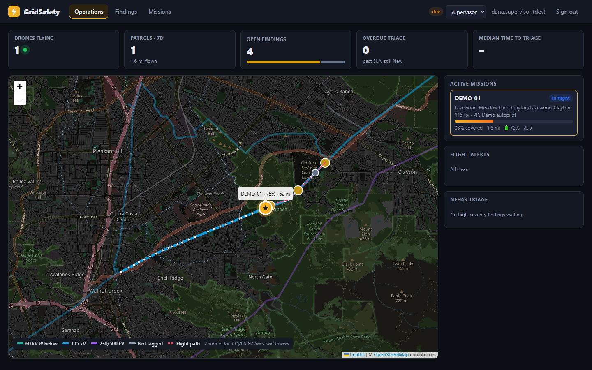

| Field crews on the roads | Reports: all activity, with costs |
|---|---|
| 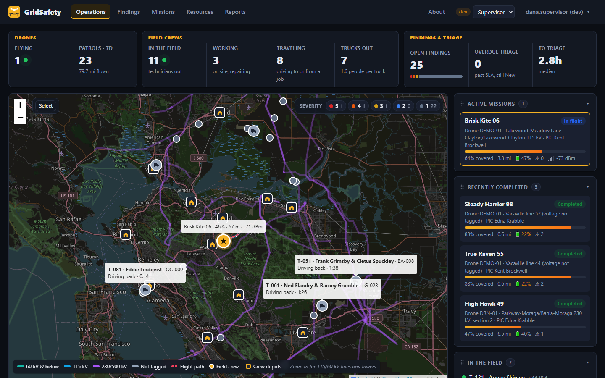 | 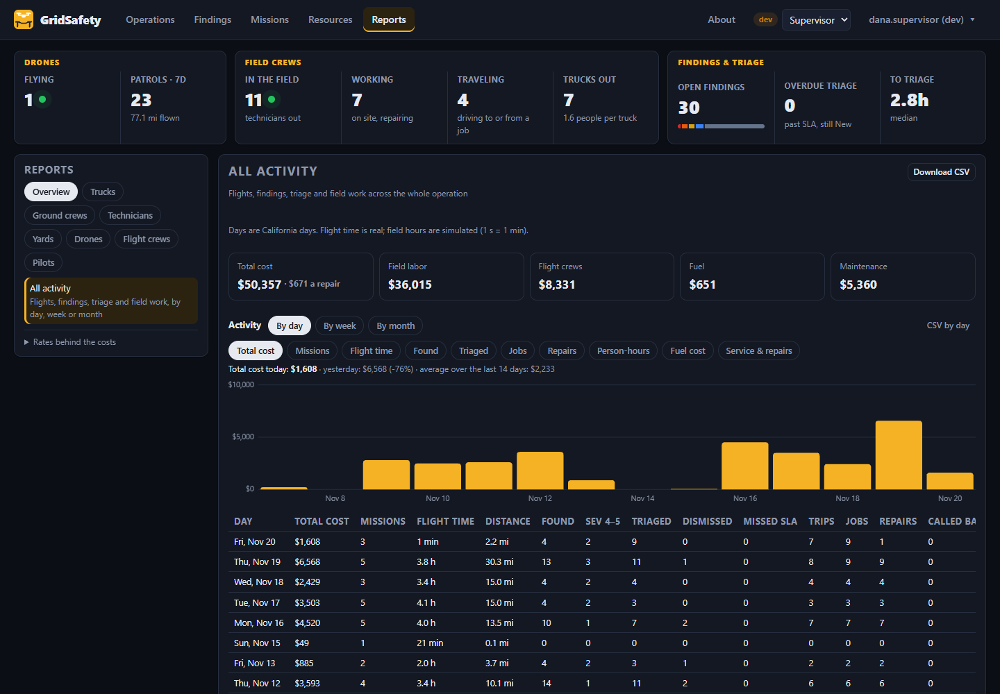 |

| Finding with its drone capture | Findings work queue |
|---|---|
| 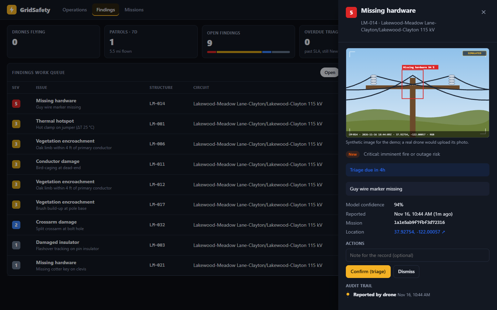 | 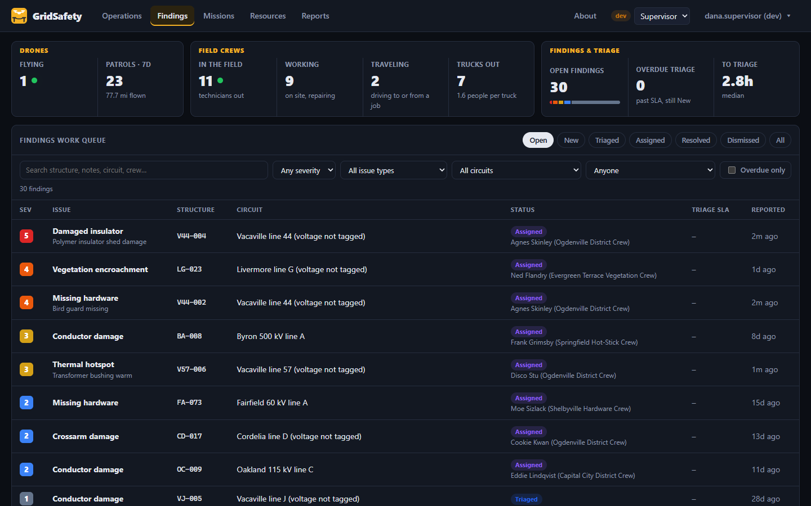 |

<details><summary>Reports: a technician's weeks and a truck's days, with labor, fuel and maintenance costs</summary>

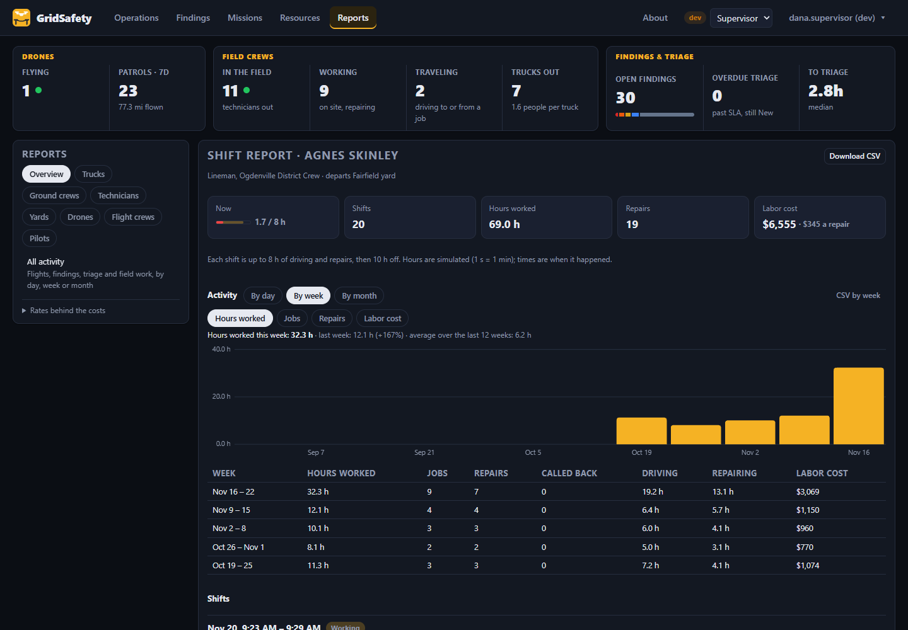

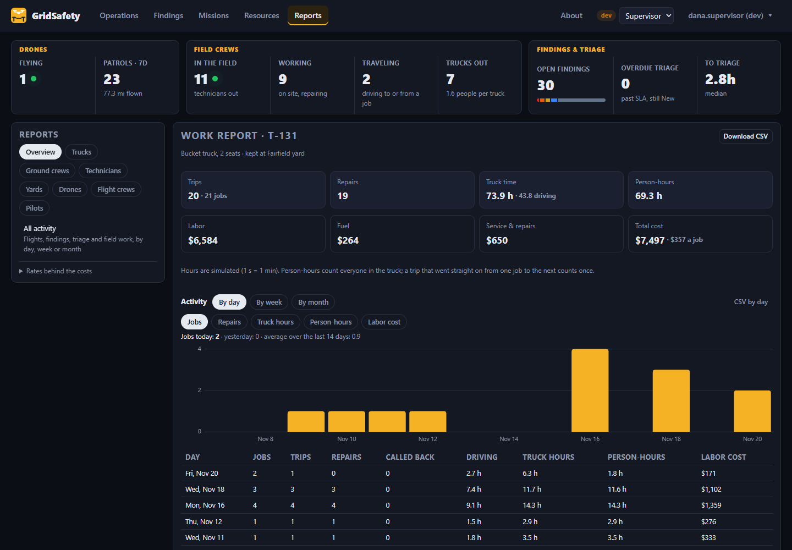

</details>

<details><summary>Resources: trucks with fuel, service and what each is doing now</summary>

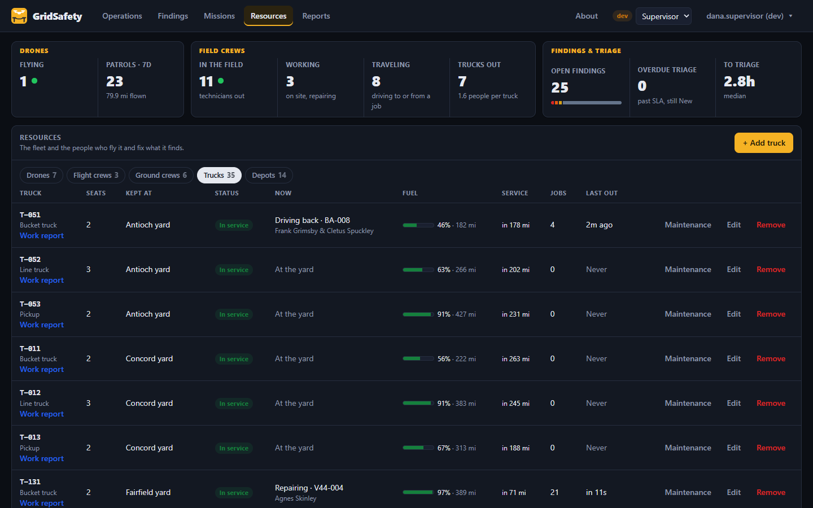

</details>

<details><summary>Mission overview: map, flight profile, captures, alerts and history</summary>

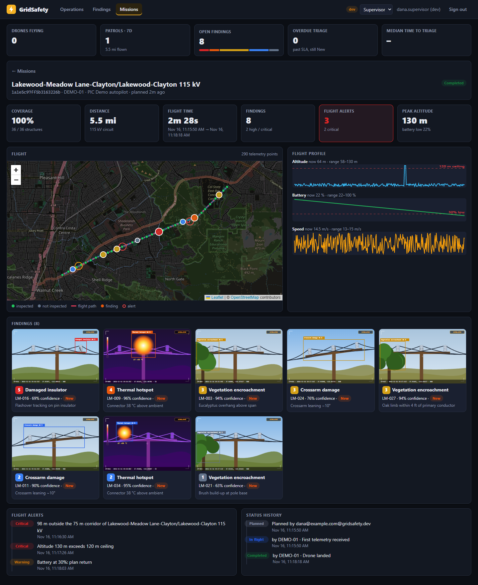

</details>

<details><summary>Missions and the synthetic defect images</summary>

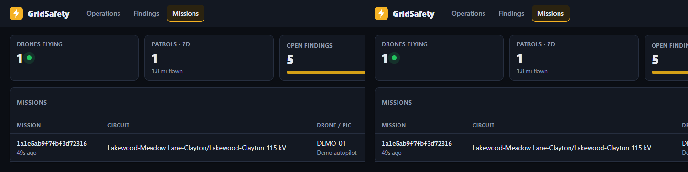

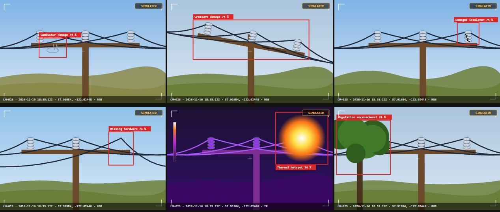

</details>

---

## Project scope: a SaaS proof of concept

GridSafety is a **proof of concept for a software-as-a-service product**: one hosted platform that utilities and drone inspection contractors would subscribe to, instead of each building their own pipeline from drone to defect to repair. This repository is the first working slice. It runs as a single demo deployment with real public map data and simulated drones, defects and field crews, and it is built so the parts a paying customer would rely on (the event pipeline, the workflow rules, security and cost) are real rather than mocked.

**Who it's for:** utility asset-inspection and vegetation-management teams, drone service providers who inspect lines for several utilities, and smaller co-ops and municipal utilities without their own engineering team.

**The problem:** drone programs collect far more imagery than teams can review, and defects get lost between the inspection, the triage decision and the crew that fixes them. GridSafety covers that whole loop in one place: fly → detect → alert → triage on an SLA → dispatch the nearest qualified crew → repair → report.

### What the proof of concept shows

| Question a buyer would ask | What's here |
|---|---|
| Can it take live drone data at scale? | MQTT telemetry through AWS IoT Core into an event-driven, serverless pipeline, with per-device identity, idempotent processing and out-of-order tolerance |
| Does it fit how operations actually work? | Flight-safety alerts, a triage queue with severity-based SLAs and escalation, work orders that go only to qualified, on-shift technicians nearest first, crew hours of service, trucks tracked per yard with crews riding together and nearby jobs chained onto the same trip, and an audit trail on every decision |
| Can managers see what happened? | Live ops map, KPIs, a mission overview and downloadable report per flight, flight logs and work reports for every drone, pilot, crew, truck and yard, by day, week or month (CSV) |
| Is it secure? | Cognito sign-in with role-based rights enforced by the API, a read-only guest view with names removed, least-privilege IAM per function, CI/CD through OIDC with no long-lived keys |
| What does it cost to run? | Pay-per-use AWS services only: an idle deployment costs close to nothing, and a budget alert watches spend (default $5/month) |
| Can it be operated? | Structured logs, business metrics, a CloudWatch dashboard, alarms on every failure path and dead-letter queue |

### Real vs. simulated

| Real | Simulated |
|---|---|
| Power lines and towers (public OpenStreetMap data, operator and owner tags removed) | Drones and their flights (the same pipeline a real drone would use) |
| Aerial photos of each structure (USDA NAIP, public domain) | Defect detection and the drone captures (badged **SIMULATED**) |
| Road routes for crew trucks (public OSRM routing) | Field crews, truck rolls and repairs (sped up: 1 s = 1 simulated minute) |
| The AWS architecture, security, alerting and CI/CD | People: every pilot and technician is fictional |

No non-public utility data is used anywhere in the project.

### What a production SaaS would add (out of scope here)

- **Multi-tenancy:** an organization per customer, with tenant-scoped data keys, sign-in, settings and storage, and per-tenant limits.
- **Customer onboarding:** importing each customer's own line and asset data (GIS exports) in place of OpenStreetMap, and their crews, yards and drone fleet.
- **Real drones and detection:** integration with drone vendors' fleet APIs, photo and video upload to S3, and a trained defect-detection model with a human review loop.
- **Integrations:** pushing work orders to the customer's work-management or EAM system, and enterprise single sign-on (SAML/OIDC).
- **Field app:** a mobile app for crews to accept jobs, navigate, record repairs and close work orders offline.
- **Compliance:** security certification (for example SOC 2), handling of critical-infrastructure data rules, and record-keeping for FAA drone operations.
- **Billing:** subscription plans and usage metering (for example by line miles inspected or by seat).

## What it does

| Area | Behaviour |
|---|---|
| **Live ops map** | Circuits colored by voltage, structures, drones moving in real time, the active mission's flight track, and findings sized and colored by severity. |
| **Flight-safety rules** | Every telemetry point is checked against low/critical battery (30% / 15%), the 120 m altitude ceiling (FAA Part 107), and the circuit's right-of-way corridor. An alert fires **once per onset**; a sustained condition does not page again. |
| **Findings → work orders** | `New → Triaged → Assigned → Resolved`, or `Dismissed`. A work order goes only to an on-duty technician (or whole crew) qualified for that defect type, and the picker lists them nearest depot first, so the closest qualified tech is the default; the API refuses anyone unqualified. Assigning sends a simulated truck (sped up) along real roads (public OSRM routing, straight-line fallback) to the site, repairs, closes the work order and drives back; the technician is busy meanwhile, except that a job within 15 km of where they already are can be lined up after their current one (up to 4 stops), so they drive on instead of returning. Trucks, their road ahead and an In the field panel show on the Operations map. Technicians work up to 8 h of driving and repairs per shift, then rest 10 h (sped up: 1 s = 1 min); jobs that would not fit are not offered, and a Crew shifts panel shows who is working or resting. On the map, Shift/Ctrl-click or drag a box (or use Select mode) to triage or assign several findings at once. **Only Supervisors (Cognito group) may dismiss**, which the API enforces as well as the UI. Every move is audited with who, when and a note. |
| **Resources** | One place for the drone fleet, flight crews (remote pilots and visual observers) and ground crews. Supervisors add, edit and take things out of service. A drone in maintenance can't be planned, an off-duty crew takes no new work orders, and an edit that would orphan an open work order is refused. Each drone shows its live state, flight time and distance; each crew shows its missions or open work orders. Ground crews depart from depots (yards); each technician has their own skills and can depart from a different depot than their crew. Depots appear on the Operations map with who leaves from each. Reports: each drone and pilot has a flight log (missions, flight time, distance, findings, alerts) and each technician a shift report (hours, driving vs repairs, every job), all downloadable as CSV. Maintenance is simulated from what each asset has done: trucks burn fuel along their actual routes and fill up at the yard when they get back under half a tank, and go in for service every 300 road miles; drones fly on a rotation of battery packs that recharge after each flight and wear with every cycle (replaced under 70% health), with an inspection every 2 flight hours. Supervisors log repairs (in the shop for a set time, or until marked back) and services. Anything refueling, charging, in service or in the shop can't be dispatched or flown, and every refuel, swap, service and repair lands in the asset's maintenance log and in the reports. Reports have their own **Reports** tab, opening on **All activity** (the whole operation day by day: missions, flight time, findings found and triaged, field jobs, repairs, person-hours); or pick a truck, crew, technician, yard, drone, flight crew or pilot; each report has a shareable link, and the links on Resources open it there). Every report also breaks down by day, week or month (Pacific calendar days, Monday-start weeks): a chart of the chosen measure over the last 14 days, 12 weeks or 12 months, this period against the last, and a table of every period. Every report carries costs from one rate card in `Core/Costs.cs` (illustrative figures: $95 per technician person-hour, $140 per flight-crew hour, $4.90 a gallon, plus service, inspection, battery pack and repair prices; a logged repair can carry its own cost). All activity totals labor, flight crews, fuel and maintenance by day, week or month, and the rates behind the numbers are listed alongside. |
| **Email alerts** | Supervisors choose which events email the on-call team (critical findings, overdue triage, critical flight alerts, mission complete), the finding severity threshold, and up to 10 recipients (user menu → **Email alerts**). The notifier Lambdas read the settings before every page. Recipients are SNS email subscriptions: each address gets a confirmation link from AWS, so nothing has to be verified in the account. |
| **Triage SLA** | Severity 5 must be triaged within 4 h, severity 4 within 24 h and severity 3 within 72 h. A one-time EventBridge Scheduler timer is set per finding. If the finding is still untriaged when the timer fires, it is escalated to the ops SNS topic. Triaging cancels the timer. |
| **Paging** | Critical drone alerts and severity 4–5 findings pass through an SQS buffer, then an idempotent notifier, then SNS (email/SMS/PagerDuty). |
| **On-demand demo flights** | A Supervisor presses **Demo flight** and a simulated drone flies one of the real lines for 2–4 minutes, through the same pipeline a real drone uses. Nothing runs on a schedule, so an idle deployment costs nothing. One demo flight at a time; a demo mission that stops reporting for 10 minutes is aborted automatically. Supervisors can also press **Simulate flight** on any planned mission to fly it the same way, under its own drone and pilot. At most 3 simulated flights are in the air at once. |
| **Mission overview** | One page per flight (`#mission/<id>`, linkable): coverage, distance, flight time, findings and alerts; a map of the line with inspected and missed towers, the flight path, findings and alert spots; altitude, battery and speed over the flight against their limits; every finding's capture; the alert timeline, status history and towers still to inspect. Live while the drone is up, and available to guests. |
| **Mission reports** | When a mission completes or aborts, a self-contained HTML report is written to S3: the track as SVG, findings with a capture of each, alerts, and any structures not inspected. Users download it through a presigned URL. |
| **Defect images** | Each finding gets a synthetic drone capture (SVG): the structure with the defect drawn in, the detector's bounding box and confidence, a GPS/time overlay, and a **SIMULATED** badge. Thermal hotspots render in an IR palette. Images are drawn from the finding's id, so they never change and nothing is stored; a real drone would upload photos to S3 instead. |
| **Guest view** | Signed-out visitors see the live site read-only: the map, flights, findings with their images, and reports. They use `GET /api/public/*`, which has no sign-in but only maps reads; names and emails in audit trails become "Ops user" and no actions are offered. Every write still goes through the Cognito JWT authorizer. |
| **Ops KPIs** | Active missions, drones flying, miles flown in the last 7 days, open findings by severity, overdue triage, and median hours to triage. |

## Architecture

```mermaid
flowchart LR
  subgraph Field
    D[Drone / Simulator]
  end
  U2[Supervisor: Demo flight] -.-> API2[API] -. async invoke .-> DEMO[DemoFlight λ] -- publishes like a drone --> IOT
  D -- MQTT gridsafety/drones/{id}/{kind} --> IOT[IoT Core<br/>topic rule]
  IOT --> ING[DroneIngest λ]
  ING --> DDB[(DynamoDB<br/>single table)]
  ING -- DroneAlertRaised --> BUS
  DDB -- stream SK=META --> PUB[StreamPublisher λ<br/>outbox]
  PUB --> BUS{{EventBridge bus}}
  BUS -- FindingCreated/StatusChanged --> SLA[SlaScheduler λ]
  SLA -- at&#40;due&#41; --> SCH[EventBridge Scheduler]
  SCH --> ESC[SlaEscalation λ]
  BUS -- Critical alert / sev≥4 --> Q[SQS + DLQ] --> NOT[AlertNotifier λ]
  ESC --> SNS[[SNS ops pages]]
  NOT --> SNS
  BUS -- Mission Completed/Aborted --> REP[MissionReport λ] --> S3[(S3 reports)]
  BUS --> ARC[(Archive 30d)]

  U[Ops console<br/>React] --> CF[CloudFront]
  CF --> SITE[(S3 SPA)]
  CF -- /api/* --> APIGW[HTTP API<br/>Cognito JWT] --> API[ASP.NET Core λ]
  API --> DDB
  API -. presigned GET .-> S3
```

### Projects

| Path | What |
|---|---|
| `src/GridSafety.Core` | Domain: missions, findings, workflows, flight rules, geo math, SLA policy, ingest service, DynamoDB + in-memory repositories |
| `src/GridSafety.Api` | ASP.NET Core Minimal API, which runs on Lambda and also locally with Kestrel |
| `src/GridSafety.Functions` | Event handlers: DroneIngest, StreamPublisher, SlaScheduler, SlaEscalation, AlertNotifier, MissionReportGenerator, plus the on-demand DemoFlight |
| `tools/GridSafety.CircuitImport` | Pulls real power lines + towers from OpenStreetMap (Overpass API) and builds the circuit dataset |
| `tools/GridSafety.Simulator` | A drone that flies a circuit, with scripted incidents, posting to the local API or publishing to IoT Core |
| `web/` | React ops console: live map, findings queue, missions |
| `infra/` | AWS CDK app in C# (~100 resources) |
| `tests/GridSafety.Tests` | xUnit tests covering domain, ingest, events, SLA, paging, reports, OSM import and HTTP/RBAC (76 tests) |

## Run it locally (no AWS account needed)

Prerequisites: .NET 10 SDK and Node 20+.

```bash
dotnet run --project src/GridSafety.Api --launch-profile GridSafety.Api
```

```bash
npm --prefix web install && npm --prefix web run dev
```

```bash
dotnet run --project tools/GridSafety.Simulator -- --circuit PITT-MART-115 --speed 3
```

Open http://localhost:5173 and watch the drone fly. Or skip the simulator: as a Supervisor, press **Missions → Demo flight**, and the API flies a demo drone over a random line in-process. In local mode the API uses an in-memory store and dev headers instead of Cognito. Use the **Inspector / Supervisor** switch in the header to see RBAC in action: only a Supervisor can dismiss a finding.

Simulator options: `--list` (show circuits), `--circuit PITT-MART-115`, `--drone DRN-07`, `--speed 5`, `--seed 42`, `--no-incidents`, `--aws --mission <id>`.

For reports with history behind them, start the API with four weeks of simulated operations instead (in-memory only): flights on most weekdays, the findings they turned up, triage, repairs dispatched to the nearest qualified technician with a free truck, refuels and services. It is seeded from a fixed number, so it looks the same every run. The screenshots above come from it.

```bash
dotnet run --project src/GridSafety.Api --launch-profile "GridSafety.Api (demo history)"
```

To use DynamoDB Local instead of memory:

```bash
docker compose up -d
```

```bash
dotnet run --project src/GridSafety.Api --launch-profile "GridSafety.Api (DynamoDB Local)"
```

## Map data (OpenStreetMap)

`src/GridSafety.Core/Data/circuits.json` is generated, not hand-written. In a utility this would be the scheduled GIS/asset-registry sync; here the importer plays that role:

```bash
dotnet run --project tools/GridSafety.CircuitImport
```

It queries the Overpass API for `power=line|minor_line` and town names inside a county boundary (default: `--area "Contra Costa County"`), clipped to a bounding box (`--bbox s,w,n,e`). `--area none` imports just the bounding box, e.g. `--area none --bbox 37.92,-122.19,38.05,-122.03` for Martinez + Pleasant Hill. Operator and owner tags are stripped from the response before anything is saved. Then it:

1. **fills in missing voltages**: about a third of the segments have no `voltage` tag. An untagged line takes the voltage of the lines it continues, but only when they all agree, and distribution (`minor_line`) is never guessed. Anything still unknown is kept and shown as *voltage not tagged*;
2. groups segments by voltage and stitches them end to end, but **only through two-way splices**, so lines meeting at a substation stay separate circuits;
3. clips each chain to the area, drops vertices less than 20 m apart (duplicate gantry nodes), and drops pieces under 400 m, which are almost always substation hookups (`--min-length 0` keeps them);
4. names circuits from the OSM `name`/`ref` tags (a voltage already in the name, like *500KV*, is normalized). Unnamed lines are named after the nearest town (*Vine Hill 60 kV line A*, id `VH-60-A`). It also sets the inspection corridor by voltage (60 / 75 / 100 m for 60 / 115 / 230+ kV);
5. keeps the OSM way and node ids on every circuit and structure, so each tower traces back to its source.

The current dataset has **878 circuits, about 3,079 km of line and 19,681 structures** (about 4.5 MB): 21 at 500 kV, 170 at 230 kV, 135 at 115 kV, 52 at 60/69 kV, 7 tagged 12/21 kV feeders, and 493 with no voltage tag. Use `--max <n>` to keep only the longest lines.

The operations map stays responsive at county scale by drawing on a canvas and filtering by zoom: zoomed out it shows only the 230/500 kV backbone, 115 kV appears from zoom 11, everything else from zoom 13, and tower dots from zoom 14. Only lines inside the view are drawn, and the circuit a drone is flying is always shown with its towers.

Public Overpass servers are often busy, so a snapshot of the response is committed. Rebuild from it offline with:

```bash
dotnet run --project tools/GridSafety.CircuitImport -- --input tools/GridSafety.CircuitImport/data/contra-costa-overpass.json
```

The live dataset covers three counties (`--area` takes several, separated by commas). Their snapshot was fetched one county at a time and merged, since the public servers time out on the combined query:

```bash
dotnet run --project tools/GridSafety.CircuitImport -- --input tools/GridSafety.CircuitImport/data/east-bay-overpass.json --area "Contra Costa County,Alameda County,Solano County" --bbox 37.44,-122.45,38.55,-121.46
```

Data © OpenStreetMap contributors, available under the ODbL. The map credits it.

## Aerial photos (USDA NAIP)

Each finding's capture is shown over a real aerial photo of its structure: a 160 × 100 m frame (about 60 cm per pixel) of [USDA NAIP](https://naip-usdaonline.hub.arcgis.com/) orthoimagery from the [USGS National Map](https://imagery.nationalmap.gov/arcgis/rest/services/USGSNAIPImagery/ImageServer), which is public domain. The detection box, camera overlay and defect are simulated, and the frame is badged SIMULATED and credits the imagery. An illustrated close-up is still available, since a top-down photo can't show an insulator.

An export takes 15–30 s, so it never happens on a page view. A `FindingCreated` rule invokes the `AerialImagery` Lambda, which fetches the frame while the drone is still flying and caches it in DynamoDB, once per structure (`AERIAL#{structureId}`). Opening an older finding starts the same fetch and the drawer shows a spinner until it's ready. Only the structure's public coordinates are sent to USGS.

## Test

```bash
dotnet test GridSafety.slnx
```

```bash
npm --prefix web test
```

## Deploy to AWS

```bash
scripts/deploy.sh dev -c opsEmail=you@example.com
```

This publishes the Lambdas (linux-arm64, ReadyToRun), builds the SPA, and runs `cdk deploy`. After deploying:

1. Create users in the Cognito pool and add supervisors to the `Supervisors` group.
2. Press **Missions → Demo flight** as a Supervisor to watch a simulated drone fly through IoT Core. It runs only when pressed and takes 2–4 minutes. To fly your own mission from your machine instead, attach the `SimulatorPolicyArn` output to your IAM user, plan a mission in the console, then:
   ```bash
   dotnet run --project tools/GridSafety.Simulator -- --aws --drone DRN-07 --mission <missionId>
   ```
3. Confirm the SNS email subscription to receive pages. The same `opsEmail` also gets **AWS Budget alerts** (see Cost below).

GitHub Actions: `.github/workflows/ci.yml` builds, tests and runs `cdk synth` on every push and PR. `deploy.yml` is run by hand (**Actions → Deploy → Run workflow**) and deploys through GitHub OIDC with no stored AWS keys (see `docs/github-oidc.md`).

**Cost:** everything is serverless and pay-per-request. With simulated drones only, a stack costs about $1–2 a month, mostly CloudWatch logs and alarms. Demo flights run only on demand; each costs well under a cent (a few hundred IoT messages and Lambda invocations). CloudWatch custom metrics, often the surprise line item, are kept to **5 series**, inside the always-free 10:

| Kept as custom metrics | Replaced by free AWS metrics |
|---|---|
| TelemetryPoints, FindingsReported, DroneAlerts, MessagesRejected, SlaEscalations | Pages sent → SNS `NumberOfMessagesPublished`; reports and SLA timers → Lambda `Invocations`; events published → logs; cold starts → `Init Duration` in the Lambda logs (Powertools `CaptureColdStart` would add one billed series per function) |

`CostGuardTests` fails the build if a handler turns cold-start capture back on or emits a metric that isn't on the list. The free allowance is per account, so other workloads in the same account share it.

**Budget alert:** when `opsEmail` is set, the stack also creates an AWS Budget (`GridSafety-<stage>-monthly`, default **$5/month**) that emails at 85% and 100% of actual spend, and as soon as the month's *forecast* goes over. It covers the whole account and only alerts; nothing is shut off. Change it with `-c monthlyBudgetUsd=10`, or `-c monthlyBudgetUsd=0` to skip it (for example on a second stage in the same account).

## Design decisions

- **Device identity comes from the topic, not the payload.** The IoT rule injects `topic(3) AS droneId`, and the IoT policy only lets a Thing publish under `gridsafety/drones/${ThingName}/*`. A compromised drone cannot report as another drone.
- **Transactional outbox through DynamoDB Streams.** State changes are written once. The stream publisher turns them into domain events, so there are no dual writes. A stream filter (`SK = META`) keeps telemetry and idempotency records from invoking it at all.
- **Optimistic concurrency.** Every entity carries a `Version`, and writes are conditional. Concurrent telemetry and finding messages for one mission retry instead of losing updates (this is tested).
- **Out-of-order tolerant.** The drone "shadow" only moves forward in time (`LastSeen <= :ts`). Late MQTT QoS 1 redeliveries don't jump a drone backwards on the map.
- **At-least-once everywhere, effects exactly once.** The SQS notifier uses partial batch responses and a DynamoDB idempotency key per event. SLA escalation is guarded by an `Escalated` flag, so a duplicate scheduler fire never pages twice.
- **Alert onset, not alert spam.** Alerts fire on the transition into a condition. LowBattery is suppressed while CriticalBattery is active.
- **Ops-grade observability.** Powertools structured logs and a small set of EMF business metrics, alongside free AWS service metrics, feed a CloudWatch dashboard. Alarms cover Lambda errors, API 5xx, stream iterator age and every DLQ, and all of them go to an SNS alarm topic.
- **Least privilege.** Each Lambda gets only the grants it needs. The scheduler role can invoke only the escalation function.

## Why I built this

I've spent the last couple of years supporting grid operations software (ADMS on-call/production support) at a large utility, and before that building DevOps automation, secure pipelines and integrations. GridSafety applies that experience to a growing problem for utilities: inspecting thousands of miles of line with drones and getting defects to crews before they become outages or ignition sources.

| Skill shown | Where |
|---|---|
| Production-support mindset: alerting, SLAs, runbook-friendly events | Flight rules, SLA escalation, paging, DLQ alarms, dashboard |
| Event-driven cloud architecture | IoT Core → Lambda → DynamoDB Streams → EventBridge → Scheduler/SQS/SNS |
| Infrastructure as code | `infra/GridSafetyStack.cs` (CDK in C#) |
| Secure CI/CD | GitHub Actions with OIDC, no long-lived keys |
| RBAC / identity | Cognito groups → JWT authorizer → API-enforced Supervisor rights |
| Automation and testing | Simulator with scripted incidents; 211 .NET tests + frontend tests |
